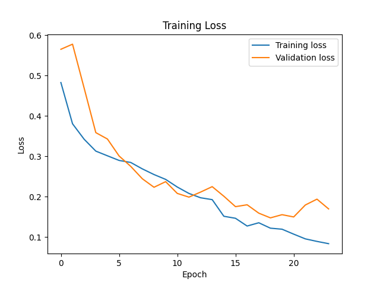

# Brain Tumor Detection CNN

This is a machine learning model that classifies whether an MRI of a brain contains a tumor or not using Tensorflow and sklearn.

Dataset source: https://www.kaggle.com/datasets/jakeshbohaju/brain-tumor

A custom convolutional neural network (CNN) is trained from scratch and compared against a pretrained MobileNetV2 model on the same data.

## How it works

- **Removing duplicate images:** The dataset contains duplicate and near-identical images. Before splitting, each image is shrunk and hashed, and only the first copy of each is kept, removing 248 of 3,762 images. Without this, copies of the same image can end up in both the training and testing data, letting the model memorize test images.
- **Train / validation / test split:** The data is split 70/15/15 with stratification, so each set has the same ratio of tumor to no-tumor images. The validation set is used for early stopping, and the testing set is only used once at the end.
- **Data augmentation:** Training images are randomly flipped, rotated, and zoomed so the model sees more variety.
- **Custom CNN:** Three convolution layers (16 → 32 → 64 filters), each followed by max pooling, then a dense layer with 128 neurons and an output layer with 2 classes.
- **MobileNetV2:** A model pretrained on ImageNet, with a new output layer trained on the MRI images.
- **Evaluation:** Precision and recall are reported for the "Tumor" class, since missing a tumor is the costly mistake.

## Results

Testing set: 528 images (283 no tumor, 245 tumor).

| Model | Accuracy | Precision (tumor) | Recall (tumor) |
|---|---|---|---|
| Custom CNN | 93.2% | 94.8% | 90.2% |
| MobileNetV2 (pretrained) | 92.8% | 95.2% | 89.0% |



## Limitations

- The dataset has no patient IDs, so different slices from the same patient's scan can still appear in both the training and testing data. The duplicate check only removes near-identical images.
- With 528 testing images, accuracies within about 2 percentage points of each other are effectively tied.

## How to run

1. Download the dataset from Kaggle and place it next to the notebook in this layout:
   ```
   Brain Tumor Dataset - ML/
   ├── Brain Tumor.csv
   └── Brain Tumor/
       ├── Image1.jpg
       ├── Image2.jpg
       └── ...
   ```
2. Install the required libraries and modules, and open the notebook:
3. Run all cells from top to bottom.
